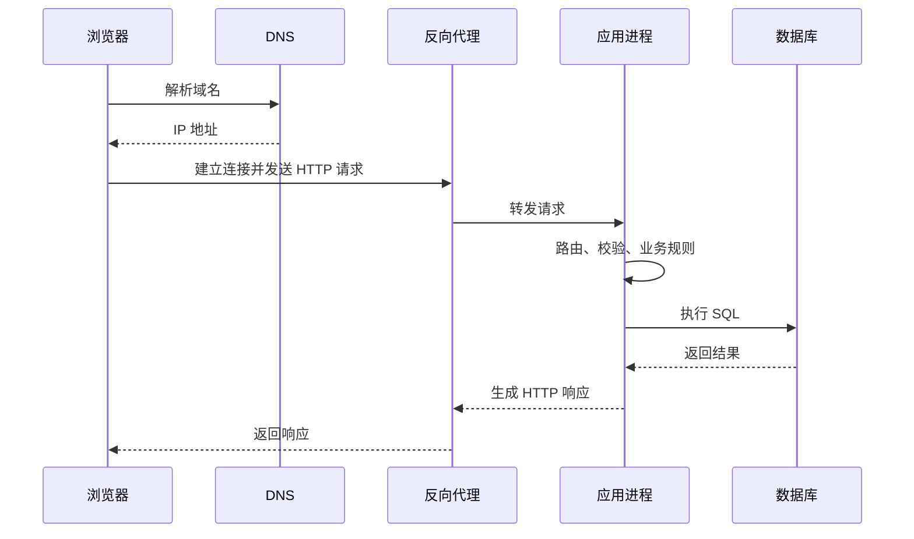

# 01丨后端开发全景

这套文档从一段能单独运行的程序出发，终点是一项能被许多客户端同时访问、重启后数据仍在、出错时能定位原因的服务。本章先把从浏览器发出请求到数据库返回结果的整条链路走一遍，说明其中每个环节的名字与职责；后续各章再逐个展开这些环节的机制与实现。

---

## 从本地程序到服务

本地程序的输入来自命令行、文件或标准输入，输出写到终端，进程结束，状态随之消失。后端服务不是这样：它需要长时间运行，等待来自网络的请求，把结果写回网络，并把需要保留的数据交给独立的存储进程。在这套文档里，**服务 (Service)** 指一个长期运行、通过网络接收请求并返回响应的程序。

发起请求的一方称为**客户端 (Client)**，浏览器、移动应用与另一个服务都可以是客户端。客户端发出的数据称为**请求 (Request)**，服务返回的数据称为**响应 (Response)**；两者都按约定好的格式编码，接收方按同一格式解析。

两者的差别不只在运行时长。本地程序一次只处理一个输入，失败只影响这一次运行；服务同时面对许多客户端，任何一个环节变慢或失败，都可能波及所有在线请求。下面的对照列出几项直接影响代码结构的差异。

| 维度 | 本地程序 | 后端服务 |
|---|---|---|
| 启动方式 | 运行一次，处理完退出 | 常驻，持续等待请求 |
| 输入 | 命令行、文件、标准输入 | 网络请求 |
| 输出 | 终端、文件 | 网络响应、日志 |
| 状态 | 随进程结束消失 | 由数据库等外部存储保存 |
| 失败影响 | 只影响本次运行 | 可能影响所有在线客户端 |

这张表里的「常驻」与「外部存储」决定了后端代码的基本形状：程序不能在处理完一个请求后退出，也不能把数据只放在内存变量里。代码需要把「接收请求」「处理业务」「读写数据」「返回响应」分成可以分别测试与替换的部分，否则一处失败会牵连整条链路。

---

## 一次请求的完整链路

把一次请求拆开，可以看到它依次经过域名解析、连接建立、请求传输、应用处理与数据读写几个阶段。每个阶段都可能失败，失败的表现与处理方式各不相同；后续章节会逐个展开，这里先建立整条链路的轮廓。

浏览器首先要把地址中的域名换成 IP 地址。**IP 地址 (Internet Protocol Address)** 是网络中一台主机的编号，**域名系统 (Domain Name System, DNS)** 负责把便于记忆的域名解析成 IP 地址。解析结果可能来自本机缓存、运营商缓存或上级域名服务器，因此同一域名在不同时间、不同网络下可能得到不同的地址。

拿到地址后，客户端与服务器建立 **TCP (Transmission Control Protocol)** 连接。TCP 提供一条可靠的字节流通道：发送方写入的字节会按顺序到达接收方，丢失的部分由协议重传。地址以 `https` 开头时，双方还会在 TCP 之上进行 **TLS (Transport Layer Security)** 握手，协商密钥并加密后续数据。连接建立完成，客户端才发送 HTTP 请求。

**HTTP (Hypertext Transfer Protocol)** 是请求与响应的格式约定：请求行说明方法、路径与协议版本，首部列出附加信息，正文携带数据；响应以状态码开头，后接首部与正文。请求通常先到达**反向代理 (Reverse Proxy)**，它位于客户端与应用之间，负责终止 TLS、转发请求、分摊流量与限制访问频率。反向代理再把请求交给真正运行应用代码的进程。

应用进程里有一个 HTTP 服务器，负责监听端口、解析请求并调用应用代码。应用代码根据请求的路径与方法选择处理函数，读取参数，执行校验与业务规则，必要时访问数据库。**数据库 (Database)** 是独立运行的存储进程，应用通过 SQL 语句查询或修改其中的数据；数据库把结果返回给应用，应用再把它写成 HTTP 响应，沿原路返回给客户端。

下面的时序图把上述环节按时间顺序排列，方框之间的箭头表示一次请求或响应的传递方向。图中的每个参与者对应链路中的一个角色，箭头的往返顺序即一次请求的完整路径。

图中 DNS 只参与地址解析，不参与后续的数据传输；反向代理与应用进程之间通常也是 HTTP，但可以不经过公网。应用进程内部的「路由、校验、业务规则」是后端代码的主要部分，数据库只负责存储与查询，不替应用判断业务是否允许。理解这条分工，才能判断一个问题应当由哪一层解决。

| 环节 | 主要职责 | 典型失败表现 |
|---|---|---|
| DNS | 域名到 IP 的映射 | 域名无法解析，连接尚未开始 |
| TCP 与 TLS | 建立可靠通道、加密 | 连接超时、证书校验失败 |
| 反向代理 | 转发、限流、终止 TLS | 502、504、请求被拒绝 |
| 应用进程 | 解析请求、执行代码 | 500、响应不符合约定 |
| 数据库 | 存储、查询、事务 | 连接耗尽、锁等待、约束冲突 |

---

## 服务端承担的职责

服务端代码并不只是「收到请求，返回数据」。同一条请求要经过接收、校验、业务判断、数据读写与响应生成几个职责，每个职责失败时的处理方式不同。把这些职责混在一个函数里，测试与排错都会变得困难。

### 接收与解析

服务首先要从字节流中还原出请求。HTTP 服务器负责读取请求行与首部，按 `Content-Length` 或分块编码读取正文，再把解析结果交给应用代码。请求格式不合法时，服务器直接返回 `400 Bad Request`；正文超过允许大小时，返回 `413 Payload Too Large`。这些判断发生在业务代码之前，应用代码通常看不到原始字节。

解析完成后，应用代码拿到的是路径、方法、首部与正文。正文可能是 **JSON (JavaScript Object Notation)**、表单或文件，具体格式由 `Content-Type` 说明；JSON 用文本表示对象、数组、字符串与数值，是 HTTP 接口最常用的正文格式。应用不能假定正文一定符合预期：字段可能缺失，类型可能错误，数值可能越界，这些都要在进入业务逻辑前检查。

### 校验与鉴权

请求的格式正确，不等于内容可用。**校验 (Validation)** 检查字段是否存在、类型是否正确、取值范围是否合理；例如借书请求中的图书编号必须是正整数，应还日期不能早于借出日期。校验失败通常返回 `422 Unprocessable Entity` 或 `400`，并在响应中说明哪个字段有问题。

**鉴权 (Authentication)** 与**授权 (Authorization)** 是两件不同的事。鉴权确认请求来自谁，授权判断这个人能否执行该操作。未登录或凭证无效时返回 `401 Unauthorized`；已登录但无权访问时返回 `403 Forbidden`。把两者混为一谈，会让客户端无法判断应当重新登录还是放弃操作。

### 业务规则

业务规则是这项服务区别于通用 HTTP 服务器的部分。借书时库存不能减成负数，同一读者不能同时借同一本书两册，归还后库存要恢复；这些规则由应用代码判断，数据库的约束只是最后一道防线。规则应当集中在一处，而不是散落在路由、控制器与 SQL 语句中，否则修改规则时容易漏掉某条路径。

业务规则还要考虑并发。两个请求同时读到「库存为一」，都认为可以借出，随后各自减一，库存就会变成负数。解决这类问题不能只靠「先查询再判断」，而要让判断与修改在数据库的同一个原子操作或同一个事务中完成。事务与并发控制是第 08 章的主题，这里只需记住：业务规则的正确性依赖执行顺序，而执行顺序由数据库的隔离与锁机制保证。

### 数据读写

业务规则通常需要读写持久化数据。应用通过数据库驱动发送 SQL，驱动把结果转换成语言中的对象；写入可能涉及多张表，需要**事务 (Transaction)** 保证这些操作要么全部生效，要么全部不生效。事务边界划得太小，会出现「扣了库存却没写借阅记录」；划得太大，会持有锁太久，拖慢其他请求。

数据访问代码还要处理连接的生命周期。建立数据库连接需要网络往返与身份验证，频繁建立会耗尽时间；**连接池 (Connection Pool)** 预先建立若干连接并重复使用，避免每次请求都重新连接。连接用完后不归还，池中的连接会被占满，后续请求只能等待。连接池与会话管理是第 10 章的内容，这里先指出它是服务端必须显式管理的资源。

### 响应与观测

处理完成后，服务把结果写成响应。响应要包含恰当的状态码、内容类型与正文；成功创建资源返回 `201`，删除成功可以返回 `204`，业务拒绝与程序错误应当使用不同的状态码。正文通常用 JSON，字段名与类型一旦对外发布，就构成客户端依赖的契约，不能随意改动。

服务还需要留下可观测的痕迹。**日志 (Logging)** 记录单个请求的关键事件，**指标 (Metrics)** 统计请求量、延迟与错误率，**追踪 (Tracing)** 把一次请求经过的多个服务串起来。三者都不是业务功能，却决定了服务出错时能否定位原因；第 12 章会把它们接入服务工程。

---

## 技术栈的分层

把上面的链路按代码职责切开，可以得到语言运行时、Web 框架、HTTP 服务器、数据访问层与数据库几层。每一层都替上层隐藏一部分细节，也都可能成为瓶颈；理解分层，才能在出问题时判断该改哪一层。

| 层 | 本仓库的选择 | 职责 |
|---|---|---|
| 语言运行时 | Python 3.12 | 执行应用代码，提供异步与类型支持 |
| Web 框架 | FastAPI（Python 的 HTTP 框架） | 路由、参数校验、响应序列化、依赖注入 |
| HTTP 服务器 | Uvicorn（调用框架的服务器） | 监听端口、解析 HTTP、调用应用 |
| 数据访问 | SQLAlchemy（数据库访问库）与 Alembic（迁移工具） | 生成 SQL、管理会话与迁移 |
| 数据库 | PostgreSQL（开源关系数据库） | 存储数据、执行事务与查询 |
| 入口 | 反向代理 | 终止 TLS、转发、限流、静态资源 |

**FastAPI** 是用于构建 HTTP 服务的 Python 框架，处理函数的参数与返回类型用来声明请求和响应；**Uvicorn** 是监听端口、解析 HTTP 并调用 FastAPI 的服务器，框架本身不负责网络监听。反向代理在部署时位于最外层，开发阶段通常省略。

选择 Python 的理由是开发速度快、生态完整，适合把注意力放在网络与数据概念上。代价是解释执行带来的性能上限，以及**全局解释器锁 (Global Interpreter Lock, GIL)** 对 CPU 密集型并行的限制。I/O 密集型服务可以在等待网络或磁盘时把执行权让给其他请求，从而绕开 GIL 的限制；但代码中一旦混入阻塞调用，等待中的请求都会被卡住，这一点在第 05 章会反复出现。

**Pydantic** 是 FastAPI 依赖的数据校验库，它按字段声明的类型解析数据、转换类型并生成错误信息。应用只需在函数参数与模型字段上写出类型，框架便据此完成校验；这也让「请求进来后发生了什么」变得不那么直观，因此文档会把请求生命周期拆开讲，而不是只给路由示例。

**PostgreSQL** 是独立运行的开源关系数据库，提供完整的事务、隔离级别、索引与查询计划，适合讲清数据库的核心机制。它需要独立安装与运维，测试时通常用容器启动；如果只想先跑起来，可以暂时用 **SQLite** 这个嵌入式数据库，但 SQLite 的并发模型与 PostgreSQL 差异很大，事务与锁的示例不能直接照搬。

**SQLAlchemy** 是 Python 的数据库访问库，同时提供两种接口：一种接近 SQL，直接构造语句；另一种是 **ORM (Object-Relational Mapping，对象关系映射)**，把表映射成类。**Alembic** 是配套的迁移工具，用版本脚本管理表结构变更。直接构造语句的接口适合看清语句如何生成，ORM 适合组织业务代码；ORM 隐藏了 SQL，却隐藏不了事务、索引与关联数据的读取代价，因此本仓库先讲 SQL 与事务，再讲 ORM，避免把框架当成数据库的替代品。

---

## 本仓库的学习路线

章节顺序按依赖关系安排，先让服务跑起来，再补网络与数据机制，最后收束到工程实践。前三章给出一个能运行的服务，让读者先接触请求与响应的完整过程；后面的章节再解释这个过程为什么这样设计。

| 阶段 | 章节 | 目标 |
|---|---|---|
| 跑起来 | 01–03 | 理解请求链路，写出第一个带校验的 API |
| 网络 | 04–06 | 理解 TCP、并发模型与 HTTP 客户端 |
| 数据 | 07–10 | 理解 SQL、事务、索引、连接池与 ORM |
| 工程 | 11–13 | 分层、认证、部署与完整项目 |

网络部分放在数据部分之前，是因为 FastAPI 的并发模型决定了数据库代码的写法；不了解请求如何等待，就无法判断一段数据库代码会不会阻塞其他请求。数据部分从 SQL 讲到 ORM，是为了让读者先理解语句与事务，再接受框架的封装。最后的项目把两部分接起来，并补上测试、迁移与部署。

---

## 贯穿项目

全书使用一个图书借阅服务作为收束项目。它管理图书的总册数与可借册数，允许读者借书与还书，能查询某位读者的在借列表，以及全部已超期未还的记录。功能不多，却同时涉及 HTTP 语义、参数校验、事务边界、并发扣减、索引与测试。

项目按章节逐步生长：第 03 章先给出最小的查询接口，第 07 章接入数据库，第 08 章加上借书与还书的事务，第 10 章换成 SQLAlchemy 与迁移脚本，第 11 章拆分路由、服务与仓储，第 12 章补上认证与部署配置，第 13 章完成测试与并发验收。每一章只增加当前机制所需的部分，读者可以看到一个服务如何从单文件脚本演变为可维护的工程。

---

## 小结

后端服务是长期运行、通过网络接收请求的程序，它与本地程序的差别在于并发、持久化与部分失败。一次请求依次经过 DNS、TCP 与 TLS、HTTP、反向代理、应用进程与数据库，每一段都有独立的职责与失败方式。服务端代码要分别处理接收、校验、鉴权、业务规则、数据读写与响应观测，不能把这些职责堆在一个函数里。

本仓库以 Python、FastAPI、SQLAlchemy 与 PostgreSQL 为主线，先跑通服务，再补网络与数据机制，最后用图书借阅项目收口。下一章说明 HTTP 的方法、状态码、首部与 JSON 约定，以及怎样据此设计一组稳定的 API。
